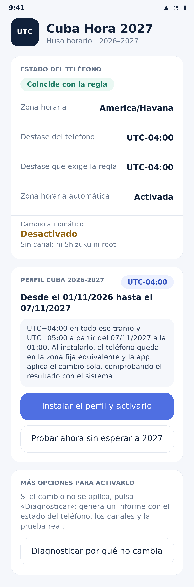

# Cuba Hora 2027 · aplicación Android

App nativa de Android que instala el **perfil Cuba 2026-2027** en el teléfono
(del 01/11/2026 al 07/11/2027), compara el desfase real con la regla del
repositorio y **aplica el cambio sola en la transición** por el primer canal
privilegiado disponible: Shizuku (sin root) o root. Sin canal explica qué zona
fija elegir en los ajustes del sistema.



- **APK publicado:** [`dist/`](../dist/) y la release de GitHub del proyecto.
- **Paquete:** `com.yhquintero.cubahora2027`
- **Android mínimo:** 6.0 (API 23, el mínimo de Shizuku). Compilado contra API 34.
- **Tamaño:** ~112 KB. No pide INTERNET ni contiene rastreadores.
- **Permisos:** notificaciones locales, aviso al reiniciar y alarmas exactas
  opcionales. Ninguno de sistema.
- **Dependencias:** solo `dev.rikka.shizuku:api` y `:provider`, fijadas a
  `12.1.0` (el resto del código usa únicamente el framework de Android).

## Qué hace

| Función | Detalle |
|---|---|
| Estado real | Lee la zona efectiva del sistema, su desfase, la hora local y el estado de la zona automática. |
| **Cambio automático** | Bloque propio en la tarjeta de estado: valor corto («Desactivado») y el detalle del canal debajo, sin partir el texto. |
| **Perfil Cuba 2026-2027** | Un botón lo instala: activa el canal, arma las alarmas y aplica el desfase vigente. El **7/11/2027 a la 01:00** cambia a UTC−05:00 sin intervención y verifica el resultado con `getprop persist.sys.timezone`. |
| **Más opciones para activarlo** | Canales alternativos en la misma pantalla: Shizuku, root (`su`), comandos para ADB, ajuste manual y **diagnóstico** con informe copiable. |
| Regla del proyecto | 2026 completo en UTC−04:00; el **7 de noviembre de 2027 a la 01:00** pasa a UTC−05:00. Sin más cambios definidos después. |
| Comparación | Indica si el desfase del teléfono coincide con la regla o si queda pendiente, y avisa si la zona automática puede deshacer el ajuste. |
| Ajuste guiado | Abre los ajustes de fecha y hora y muestra los pasos con la zona fija recomendada: **Santo Domingo** (UTC−04:00) o **Bogotá** (UTC−05:00), con alternativas y el valor GMT equivalente. Los pasos se pueden copiar. |
| Manual de aplicación | Pantalla con las tres vías reales (Ajustes, comando ADB sin root y zona automática), la verificación y cómo revertir. Cada comando se copia con un toque. |
| Recordatorios | Notificación local 7 días antes, 24 h antes y en el instante de la transición; se reprograma al reiniciar. |
| Guía offline | La guía web del proyecto, empaquetada en `assets/site`. |

## Capturas

| Pantalla | Archivo |
|---|---|
| Inicio: estado, perfil y opciones | [`docs/capturas/01-inicio.png`](../docs/capturas/01-inicio.png) |
| Tarjeta de la regla (detalle) | [`docs/capturas/02-regla-del-proyecto.png`](../docs/capturas/02-regla-del-proyecto.png) |
| Manual: perfil y canales | [`docs/capturas/03-manual.png`](../docs/capturas/03-manual.png) |
| Más opciones para activarlo | [`docs/capturas/04-opciones.png`](../docs/capturas/04-opciones.png) |

Son renders generados por `tools/render_screens.py` a partir de las medidas, colores y
textos del propio código (perfil Galaxy S22, 360 × 780 dp, densidad 3). No son capturas
de un teléfono real: sirven para documentar y revisar el diseño sin instalar el APK.
Para sustituirlas por capturas reales basta reemplazar los PNG por capturas de tu S22
con el mismo nombre.

## Perfil Cuba 2026-2027

El botón **«Instalar el perfil y activarlo»** hace todo en un toque:

1. Elige canal: Shizuku si está autorizado; si no, root; si no hay ninguno, abre
   el selector de canales.
2. Arma las alarmas de los avisos y de la transición del **7 de noviembre de 2027, 01:00**.
3. Aplica el desfase vigente y **verifica** el resultado leyendo `persist.sys.timezone`.

La tarjeta del perfil deja claro el tramo que cubre: **del 01/11/2026 al
07/11/2027**, UTC−04:00 en todo ese tiempo y UTC−05:00 a partir de la transición.

### Canales para activarlo

| Canal | Qué necesitas | Cómo se activa en la app |
|---|---|---|
| **Shizuku** (sin root) | Instalarlo, activar «Depuración inalámbrica» y pulsar *Emparejar* → *Iniciar* | «Activar con Shizuku» o el botón del perfil |
| **Root** | Teléfono rooteado con gestor operativo | «Activar con root (su)»: pide permiso al gestor y ejecuta los mismos comandos |
| **ADB** | PC, cable y depuración USB | «Copiar comandos para ADB» deja los tres comandos en el portapapeles |
| **Manual** | Solo el teléfono | «Ajustar a mano en Ajustes» con la zona fija recomendada |

Con Shizuku conviene activar «Iniciar al arrancar» para que el canal siga vivo
después de reiniciar; con root, depende del gestor. Si el cambio no se aplica,
la tarjeta «Más opciones» tiene el botón «Diagnosticar por qué no cambia», que
muestra el desfase, las zonas, el estado de cada canal y el resultado de la
prueba real, listo para copiar.

> El perfil **Cuba 2026-2027** no aparece como nombre nuevo en la lista de zonas
> del sistema: Android guarda sus zonas en la partición del sistema y solo una
> app del sistema puede añadir entradas. El perfil hace lo equivalente: pone la
> zona fija correcta y la cambia sola con verificación. El diálogo «sin canal» lo
> explica así, sin prometer lo que no puede hacer.

Qué ejecuta exactamente, como shell (UID 2000):

```bash
settings put global auto_time_zone 0        # que la red no lo deshaga
cmd alarm set-timezone America/Bogota       # cambio real (o Santo_Domingo)
getprop persist.sys.timezone                # verificación
```

Si Shizuku no está disponible en el momento del cambio (por ejemplo tras un
reinicio sin reanudarlo), la app **no inventa un éxito**: muestra una notificación
con el resultado real («aplicado» o «pendiente») y los pasos para hacerlo a mano.

## Las tres formas de aplicar el cambio

| Vía | Qué necesitas | Resultado |
|---|---|---|
| **Automático (Shizuku)** | Instalar Shizuku y autorizar una vez | La app cambia la zona en la transición y verifica. |
| Ajustes del sistema | Solo el teléfono | Cambio manual en cada transición. |
| Comando por ADB | PC, cable y depuración USB (sin root) | Cambio inmediato y permanente, también tras reiniciar. |
| Zona automática | Nada | La red decide; puede no seguir este calendario. |

```bash
# Fija el desfase que exige la regla (UTC−04:00 hasta el 7/11/2027)
adb shell cmd alarm set-timezone America/Santo_Domingo
adb shell settings put global auto_time_zone 0   # evita que la red lo deshaga

# Comprobar y revertir
adb shell getprop persist.sys.timezone
adb shell cmd alarm set-timezone America/Havana
```

`cmd alarm set-timezone` funciona porque el paquete del shell de Android
(`com.android.shell`) declara `SET_TIME_ZONE` en su manifiesto; no hace falta root ni
`pm grant`. La app no puede pedir ese permiso: solo lo consigue *prestado* por
Shizuku, y siempre con una autorización explícita del usuario.

## Por qué la app no cambia la zona por sí sola

Android no permite que una aplicación instalada por el usuario cambie la zona
horaria:

- `AlarmManager.setTimeZone()` exige `android.permission.SET_TIME_ZONE`, que en
  AOSP se declara como `signature|privileged|role`: solo lo obtienen
  aplicaciones del sistema o firmadas por el fabricante. `pm grant` no puede
  concederlo.
- Escribir la clave `time_zone` en `Settings.Global` no aplica el cambio:
  `SettingsProvider` no la observa y el sistema sigue con la zona anterior.

Una versión anterior de esta app intentaba la segunda vía con
`WRITE_SECURE_SETTINGS` y podía informar de un éxito que no ocurría. La versión
1.1.0 eliminó ese permiso y ese mensaje: ahora solo lee el estado y guía.

## Instalación en un Samsung Galaxy S22 (y otros móviles)

1. Descarga `CubaHora2027-v1.1.0.apk` en el teléfono (o desde la release).
2. Abre el archivo y, si Android lo pide, permite «Instalar aplicaciones
   desconocidas» para Archivos o Chrome. Play Protect puede advertir que la app
   no viene de Play Store: es un APK firmado por el proyecto y verificado en CI.
3. Abre **Cuba Hora 2027** y revisa la tarjeta *Estado del teléfono*.
4. Si el desfase no coincide, usa **Ver los pasos y la zona a elegir** y luego
   **Abrir ajustes**: en One UI, *Ajustes → Administración general → Fecha y
   hora*. Desactiva «Zona horaria automática» y elige la zona indicada.
5. Vuelve a la app: debe mostrar «Coincide con la regla». En Android 13 o
   superior la app pedirá permiso para las notificaciones de los recordatorios.

## Compilar

En GitHub Actions (`.github/workflows/build-apk.yml`) el APK se genera en cada
cambio y se adjunta como artefacto; el `dist/` verificado se devuelve a la rama.

Publicar una release:

```bash
# versionName de android/app/build.gradle y el tag deben coincidir
git tag -a v1.1.0 -m "Cuba Hora 2027 v1.1.0"
git push origin v1.1.0
```

El tag dispara `.github/workflows/release-apk.yml`, que verifica el APK
versionado en `dist/`, comprueba que coincida con el `versionName` y publica la
release con el APK, `SHA256SUMS` y la ficha. No recompila: publica exactamente
el binario que ya validó CI.

Localmente, con JDK 17 y Android SDK (compileSdk 34):

```bash
export ANDROID_HOME="$HOME/Android/Sdk"
bash android/scripts/build-apk.sh     # genera app-release.apk
bash android/scripts/verify-apk.sh    # valida el APK y actualiza dist/
```

La firma se toma de `android/keystore/keystore.properties` (identidad pública
del proyecto, ver [`keystore/README.md`](keystore/README.md)) o de las variables
`CUBA_KEYSTORE_PATH`, `CUBA_KEYSTORE_PASSWORD`, `CUBA_KEY_ALIAS` y
`CUBA_KEY_PASSWORD`.

## Estructura

| Ruta | Contenido |
|---|---|
| `app/src/main/java/.../MainActivity.java` | Pantalla principal y acciones. |
| `app/src/main/java/.../CubaRules.java` | Regla horaria, transiciones y etiquetas de desfase. |
| `app/src/main/java/.../OffsetGuide.java` | Zonas fijas recomendadas y pasos de ajuste. |
| `app/src/main/java/.../ManualActivity.java` | Manual: opciones, comandos ADB, verificación y reversión. |
| `app/src/main/java/.../ZoneController.java` | Lectura del estado real y apertura de los ajustes. |
| `app/src/main/java/.../ReminderScheduler.java` | Alarmas de los recordatorios (7 días, 24 h, cambio). |
| `app/src/main/java/.../Notifications.java` | Canal y notificaciones locales. |
| `app/src/main/java/.../BootReceiver.java`, `TransitionReceiver.java` | Reprogramación y avisos. |
| `app/src/main/java/.../GuideActivity.java` | Guía offline en WebView sin red. |
| `app/src/main/assets/site/` | Copia generada de la guía web. |
| `app/src/main/res/` | Iconos, tema e textos. |
| `scripts/` | Compilación, verificación y publicación del APK. |
| `keystore/` | Identidad de firma pública del proyecto. |

## Verificaciones

```bash
python3 tools/verify_registry.py        # perfiles .reg (Windows)
python3 tools/verify_android.py         # regla Java vs .reg, manifiesto, recursos, guía, manual
python3 tools/build_android_site.py --check
python3 tools/verify_release_hashes.py  # dist/ publicado
python3 tools/render_screens.py --check # capturas presentes
```

`verify_android.py` falla si la app pide INTERNET o cualquier permiso de
sistema, si el manifiesto declara componentes exportados de más, si la regla
Java deja de coincidir con los bytes de `.reg/2_Cuba_2027_Correcto.reg`, si la
interfaz vuelve a prometer un cambio automático de zona o si la guía embebida
queda desactualizada.

## Límites conocidos

- Los APK no se distribuyen por Play Store: la instalación es por *sideload*.
- La app no puede cambiar la zona horaria: Android lo reserva a aplicaciones
  del sistema. El cambio se hace una vez por transición en Ajustes.
- Los recordatorios dependen de las notificaciones y, en Android 12+, de la
  autorización de alarmas exactas; sin ella el aviso puede llegar con retraso.
- La fecha de 2027 es una lectura de los datos del repositorio, no una
  certificación oficial. Ver el aviso del [README principal](../README.md).
